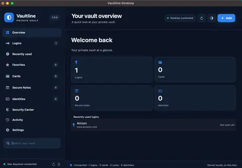
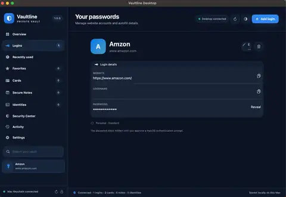
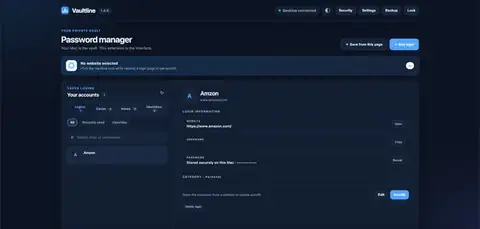
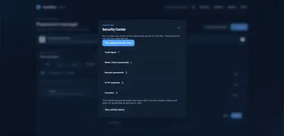
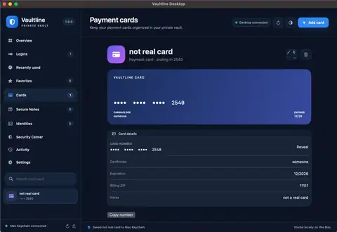

# Vaultline

<p align="center">
  
</p>

<h3 align="center">Your Mac is the vault. Your browser extension is the interface.</h3>

<p align="center">
  An open-source, local-first password manager for macOS, with a Chrome and Microsoft Edge extension.
</p>

<p align="center">
  
  
  
  
  
</p>

<p align="center">
  <a href="#features">Features</a> ·
  <a href="#screenshots">Screenshots</a> ·
  <a href="#getting-started">Getting started</a> ·
  <a href="#security-and-privacy">Security</a> ·
  <a href="#contributing">Contributing</a>
</p>

---

> [!IMPORTANT]
> **Vaultline 1.0.0 is an early open-source release and has not received an independent security audit.** Static checks do not prove that the application is secure or that every feature works correctly in a live environment. Test with disposable sample data only. Do not use Vaultline as your only protection for important accounts or store sensitive real-world credentials until the implementation has been independently reviewed and thoroughly tested.

## What is Vaultline?

Vaultline is a local-first password manager built around a simple idea: keep credential records on your Mac, while using a browser extension as the everyday interface.

The macOS app provides a native vault viewer, editor, and authentication surface. The browser extension communicates with a small native helper through Chrome Native Messaging. The helper validates supported requests and accesses the macOS Keychain.

**This release is for macOS only.** Chrome and Microsoft Edge are the supported Chromium browsers. Windows support is a future possibility, not a current feature.

## Screenshots

<p align="center">
  
  
</p>
<p align="center">
  
  
</p>
<p align="center">
  
</p>

<p align="center"><sub>Vaultline 1.0.0 interface screenshots. Usernames are redacted where they appeared; passwords and full card numbers remain masked.</sub></p>

## Features

### Passwords and vault items

- Save, view, edit, delete, search, and organize website logins.
- Match autofill suggestions against the exact normalized website hostname.
- Generate passwords and 12-word passphrases.
- Mark logins, cards, and notes as favorites; organize supported items with tags.
- View up to five previous passwords for a login.
- Filter by recently used accounts.
- Store secure notes and personal identity details.

### Browser extension

- Use the extension as the main day-to-day Vaultline interface.
- Request matching login suggestions for the current website.
- Offer a save prompt when a populated login form is detected; a record is sent to Vaultline only after the user chooses to save it.
- Fill supported login fields only after a user action. Vaultline does not submit the website's form.
- Fill supported payment-card fields on HTTPS pages after a user action.
- Use keyboard shortcuts to open Vaultline or request a save prompt.

### Payment cards

- Add, view, edit, delete, search, favorite, and tag payment-card records.
- Validate card-number format using the Luhn check.
- Support user-approved filling of supported cardholder, card-number, expiration, and postal-code fields on HTTPS pages.
- **CVV/CVC codes and card PINs are not collected, stored, or autofilled.**

### Security and settings

- Use macOS authentication through LocalAuthentication: Touch ID when available, with the Mac account password as fallback.
- Lock the vault to end the authenticated session.
- Optionally clear a copied Vaultline value from the clipboard after a delay, if the clipboard still contains that same value.
- Run local password checks for short or reused passwords and HTTP website entries.
- View local activity events for supported vault actions.
- Create and restore encrypted backups.
- Choose light, dark, or system appearance and customize supported sidebar and save-prompt preferences.

## How it works

```text
Chrome / Microsoft Edge
        |
        | Chrome Native Messaging
        v
Vaultline native helper (macOS)
        |
        | LocalAuthentication + Security framework
        v
macOS Keychain
        ^
        |
Vaultline Desktop app
```

Credential records are stored locally in the Mac's Keychain. There is no cloud vault or remote credential database in 1.0.0. The browser extension stores interface preferences in browser storage, while credential records remain in the Keychain.

The desktop window does not need to remain open for browser-extension requests; the browser launches the native helper when needed. The Mac must be available and able to authorize Keychain access.

## Getting started

### Requirements

- macOS 13 or later.
- Xcode Command Line Tools and the Swift compiler.
- Google Chrome 114+ or Microsoft Edge.
- Node.js and Python 3 for the repository's static checks and setup scripts.

### 1. Get the source

Download the repository from GitHub or clone it:

```bash
git clone https://github.com/DMONEYGAMES/Vaultline.git
cd Vaultline
```

### 2. Verify and build the Mac app

```bash
chmod +x Scripts/*.sh
./Scripts/verify-static.sh
./Scripts/build-macos.sh
open Build/Vaultline.app
```

### 3. Load the browser extension

1. Open `chrome://extensions` in Chrome or `edge://extensions` in Edge.
2. Turn on **Developer mode**.
3. Choose **Load unpacked**.
4. Select the repository's `Extension` folder.
5. Copy the extension ID shown by the browser.

### 4. Connect the extension to the Mac helper

1. For Chrome, put the extension ID in `Docs/extension_id.txt`. For Edge, use `Docs/edge_extension_id.txt`.
2. These local ID files are intentionally ignored by Git. Do not commit your personal extension ID files.
3. Run:

   ```bash
   ./Scripts/install-native-host.sh
   ```

4. Fully quit the browser with **Cmd+Q**, then reopen it.
5. Open Vaultline and test using disposable accounts and synthetic card data.

For expanded setup notes and troubleshooting, see the [build and installation guide](Docs/README.md).

## Security and privacy

Vaultline is designed to keep credential records on the Mac rather than sync them to a cloud service. That design does not, by itself, guarantee security.

Important details for this early release:

- The native helper uses an allow-list of supported commands and macOS authentication before protected operations.
- A successful authentication is cached for a short session (currently five minutes); locking ends the session.
- Login autofill uses exact normalized hostname matching and requires a user action.
- The save-password detection script runs on HTTP and HTTPS pages so it can detect populated login forms. It only sends a detected login after the user explicitly chooses the save prompt. Review this broad site access before installing.
- Card autofill is restricted to HTTPS and supported fields. CVV/CVC and PIN values are not stored or filled.
- Encrypted backups use AES-256-GCM with a PBKDF2-SHA-256-derived key. The backup passphrase is required to restore the file and cannot be recovered by Vaultline. The current backup payload limit is 600 KiB.
- Clipboard clearing is best-effort and only clears the clipboard when it still contains the value Vaultline copied.
- The Security Center performs local checks only. It does not query breach databases and its score is not a guarantee that an account is safe.

### Not included in 1.0.0

- Cloud synchronization or a hosted Vaultline account.
- Account-to-account password sharing.
- A TOTP-based second factor for unlocking the Vaultline vault.
- Remote breach monitoring.
- Windows support.
- An independent security audit.

Read the [security policy](SECURITY.md) and [release test plan](Docs/RELEASE_TEST_PLAN.md) before testing. Please do not post passwords, tokens, Keychain exports, backup files, or other sensitive data in public issues.

## Testing

Run the repository's static verification script:

```bash
./Scripts/verify-static.sh
```

Static verification checks source structure and selected contracts. It does **not** replace:

- A full native macOS build against the target Mac's SDK.
- Live Keychain and Touch ID / Mac-password testing.
- Chrome or Edge Native Messaging tests.
- Real-site autofill compatibility testing.
- An independent security review.

Use the [release test plan](Docs/RELEASE_TEST_PLAN.md) and disposable test accounts. Do not assume a passing static check means the application is production-ready.

## Contributing

Contributions, bug reports, documentation improvements, and thoughtful feature ideas are welcome.

1. Read [CONTRIBUTING.md](CONTRIBUTING.md).
2. Check existing issues before starting significant work.
3. Open an issue to discuss larger changes.
4. Submit a pull request with a clear explanation and test notes.

Security-sensitive changes require extra care. Please follow [SECURITY.md](SECURITY.md) and do not disclose vulnerabilities or sensitive data in public issues.

## Project documents

- [Build and installation guide](Docs/README.md)
- [Changelog](CHANGELOG.md)
- [Release test plan](Docs/RELEASE_TEST_PLAN.md)
- [Security policy](SECURITY.md)
- [Contributing guide](CONTRIBUTING.md)
- [MIT License](LICENSE)

## License

Vaultline is released under the [MIT License](LICENSE).

---

<p align="center">
  Made with care by <a href="https://github.com/DMONEYGAMES">DMONEYGAMES</a> · Open source, built in public.
</p>
